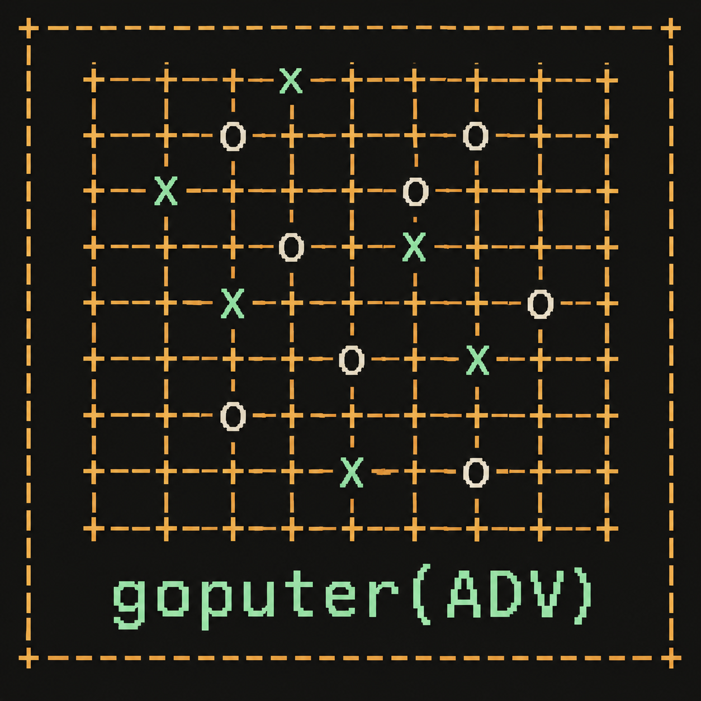

<p align="center">
  
</p>

<h1 align="center">goputer(ADV)</h1>
<p align="center"><strong>A pocket-sized game of Go for M5Stack Cardputer ADV.</strong><br>
Offline opponents · 9×9 / 13×13 / 19×19 · Save and resume · M5Launcher installation</p>

---

**goputer(ADV)** is a standalone C++/Arduino Go game for the **M5Stack Cardputer ADV**. Play against an offline bot or share the keyboard with a friend, review the result, and continue your last game after powering the device off.

The display name is `goputer(ADV)`. The Arduino sketch, folder, and application binary use the filesystem-friendly name **`goputer_ADV`**.

## Features

- **Three board sizes:** 9×9, 13×13, and 19×19; no 5×5 mode.
- **Four offline opponents:** Easy, Tactical, Search 2-ply, and Search 3-ply.
- **Choose your color:** play Black or White; Black moves first.
- **Local two-player mode:** take turns on the same device.
- **Board overview and zoom:** inspect a cursor-following 9×9 viewport on larger boards.
- **Go rules:** group captures, suicide prevention, positional superko, and passing.
- **Score review:** mark dead groups manually, accept the result, or resume play.
- **Undo:** in bot mode, return to the human player's turn.
- **Automatic flash saves:** restore the last game, including its move history.
- **No online services, external engine, or PSRAM required.** A microSD card is optional for firmware installation, not needed to play or save.

## Hardware and dependencies

Target hardware: **M5Stack Cardputer ADV / ESP32-S3 / 8 MB flash**. Other M5Stack devices and the original Cardputer are not validated targets for this project.

Use the pinned versions below rather than upgrading individual libraries blindly:

| Component | Version |
| --- | --- |
| M5Stack Arduino board package | `3.2.2` |
| M5Cardputer | `1.1.1` |
| M5Unified | `0.3.0` |
| M5GFX | `0.3.0` |
| IRremote | `4.7.1` |
| LibSSH-ESP32 | `5.10.0` |

IRremote and LibSSH-ESP32 satisfy dependencies declared by M5Cardputer; the game itself does not use IR, SSH, or networking. `Preferences` is provided by the ESP32 Arduino core and does not need a separate installation.

The pinned display setup uses `M5Cardputer.Display.setRotation(0)` and a 240×135 canvas. Preserve this setting unless you are deliberately adapting the project to another library version or display.

## See the [Arduino CLI installation guide](https://arduino.github.io/arduino-cli/latest/installation/) for installation options.

### Install dependencies

```bash
bash install-deps.sh
```

Or install the pinned dependencies manually:

```bash
arduino-cli core update-index \
  --additional-urls https://static-cdn.m5stack.com/resource/arduino/package_m5stack_index.json

arduino-cli core install m5stack:esp32@3.2.2 \
  --additional-urls https://static-cdn.m5stack.com/resource/arduino/package_m5stack_index.json

arduino-cli lib update-index
arduino-cli lib install "M5GFX@0.3.0"
arduino-cli lib install "M5Unified@0.3.0" --no-deps
arduino-cli lib install "IRremote@4.7.1" "LibSSH-ESP32@5.10.0"
arduino-cli lib install "M5Cardputer@1.1.1" --no-deps
```

Allow several gigabytes of free disk space for the board package, toolchain, and build output.

### Compile

```bash
bash build.sh
```

The script places the **app-only binary** at:

```text
dist/goputer_ADV.bin
```

The equivalent manual build command is:

```bash
arduino-cli compile \
  --jobs 2 \
  --fqbn "m5stack:esp32:m5stack_cardputer:FlashSize=8M,PartitionScheme=default_8MB,PSRAM=disabled" \
  --warnings all \
  --output-dir ./build \
  ./goputer_ADV
```

For a manual build, copy the application image to the release location:

```bash
mkdir -p dist
cp build/goputer_ADV.ino.bin dist/goputer_ADV.bin
```

The build scripts also support Linux (`build.sh`) and Windows PowerShell (`build.ps1`), with Arduino CLI and the same dependencies installed.

## Install with M5Launcher

This workflow assumes **bmorcelli M5Launcher is already installed for Cardputer ADV**.

> **Preserve Launcher and your saves:** install the app-only BIN through Launcher. Do not use `arduino-cli upload`, erase flash, or write a merged image to address `0x0` for this workflow. Do not replace the device's partition table with the one generated by the build.

1. Build `dist/goputer_ADV.bin`, or use a matching app-only binary if one is published with a release.
2. Copy the BIN to a **FAT32 microSD card** and safely eject it from your computer.
3. Insert the card into the Cardputer ADV and open **SD** in Launcher.
4. Select the BIN, choose **Install**, and wait for installation to finish.
5. Launch the installed game using the options provided by your Launcher version.

Copying a new BIN onto the card does **not** update the installed app: run **Install** again after each rebuild. If you prefer not to remove the card, use Launcher's **WUI** firmware-upload workflow instead.

Use `goputer_ADV.bin` or `goputer_ADV.ino.bin` — **not** the generated `*.bootloader.bin`, `*.partitions.bin`, or `*.merged.bin`. The game does not need a filesystem/data image.

See [Launcher's binary installation guide](https://github.com/bmorcelli/Launcher/wiki/Obtaining-binaries-to-launch) for the current UI and partition requirements.

## Start playing

In the main menu, choose the board size, opponent, your color, and bot level. Select **NEW GAME** and press **Enter**. Starting a new game requires confirmation if an existing save would be replaced.

To resume, select **CONTINUE LAST GAME** or press **L** in the menu. If the restored position is the bot's turn, it calculates its reply again.

### Menu controls

| Key                     | Action                      |
| ----------------------- | --------------------------- |
| `E` / `S`, or `;` / `.` | Select a menu row           |
| `A` / `D`, or `,` / `/` | Change the selected setting |
| `Enter` / `Space`       | Select, change, or start    |
| `1` / `2` / `3`         | Select 9×9 / 13×13 / 19×19  |
| `L`                     | Continue the saved game     |
| `H`                     | Show controls               |

### In-game controls

| Key                    | Action                                          |
| ---------------------- | ----------------------------------------------- |
| `E A S D`              | Move the cursor                                 |
| `;` / `.` / `,` / `/`  | Up / down / left / right; no Fn required        |
| `Enter` / `Space`      | Place a stone                                   |
| `P`                    | Pass                                            |
| `U` / Backspace/Delete | Undo; against a bot, return to the human's turn |
| `Z`                    | Toggle overview / 9×9 zoom on 13×13 and 19×19   |
| `F`                    | Save immediately                                |
| `L`                    | Reload the latest save, with confirmation       |
| `H`                    | Open or close help                              |
| `N`                    | Open the new-game menu, with confirmation       |
| `Q`                    | Request a reboot, with confirmation             |
| `Y`                    | Confirm a dialog                                |
| `N` / Backspace/Delete | Cancel a dialog                                 |

Movement keys repeat when held; move-placement keys do not. A blue outline marks the cursor; a contrasting dot identifies the last move.

`Q` performs a normal ESP32 restart. It is **not** a dedicated “return to Launcher” call; use your Launcher's normal menu-entry procedure after restarting.

### Score-review controls

Two consecutive passes open **SCORE REVIEW**.

| Key | Action |
| --- | --- |
| Movement keys | Select a group |
| `X` / `Space` | Toggle the entire group as dead or alive |
| `Enter` | Accept the result |
| `R` | Remove the two ending passes and resume play |
| `U` | Return to play with undo behavior |
| `Z` | Toggle zoom on larger boards |

Red crosses mark dead stones. Small black/white squares indicate ownership of empty points. There is **no automatic life-and-death adjudication**: resolve disputed groups by resuming play.

## Rules and board markings

Scoring uses **area**: surviving stones plus empty regions bordered by one color only. Mixed-border regions are neutral. Captures are displayed for reference and are not added separately to the area score. White receives **6.5 komi** on every board size.

Positional superko rejects a stone placement that recreates any board in the active game history. Passes are exempt. Undo removes the abandoned continuation from the repetition check.

Coordinates skip the letter **I**. Hoshi use global board coordinates, so zooming never relocates them.

| Board | Hoshi points |
| --- | --- |
| 9×9 | C3, G3, E5, C7, G7 |
| 13×13 | D4, K4, G7, D10, K10 |
| 19×19 | D4, K4, Q4, D10, K10, Q10, D16, K16, Q16 |

The 13×13 corner hoshi are on the **fourth line**, with the center at G7. On 9×9, corner hoshi remain on the third line.

These are project rule choices, not a claim of complete compliance with a specific tournament ruleset.

## Offline opponents

| Opponent | Approach |
| --- | --- |
| Easy | One-move heuristics with more random variation |
| Tactical | Heuristics favoring captures, atari defense, connections, and simple threats |
| Search 2-ply | Up to eight root candidates, evaluating the opponent's reply |
| Search 3-ply | Up to twelve root candidates, four selected opponent replies each, and a follow-up move |

Search modes use **bounded beam minimax** with a static evaluation of stones, vulnerable groups, and local influence. They are not exhaustive searches of the whole move tree. Quiet distant moves are pruned, and the program does not use MCTS or a neural network.

The configured thinking budgets are approximately **2 seconds** for 2-ply and **3 seconds** for 3-ply. Search runs in small chunks between input polls. These are software budgets, not hardware timing guarantees: an individual step may overrun, and large boards may stop before all candidates have been evaluated.

No kyu/dan strength is claimed. A deeper setting is not guaranteed to play better under every time-limited position, and complex ladders, life-and-death, and seki remain beyond the bot's reliable reading ability.

## Save and resume

The latest game is saved through [ESP32 Preferences/NVS](https://docs.espressif.com/projects/arduino-esp32/en/latest/api/preferences.html), using internal flash rather than the SD card.

Autosave runs after a new game starts, each committed move or pass, undo, resuming play, changing dead-group markings, and accepting a score. The move log is restored by replaying it, preserving both **undo history and superko**, not just the visible stones.

- **`Saved`** means the write completed and the stored data passed a read-back check.
- **`SAVE ERROR!`** means the latest state was not confirmed. Press `F` to retry; do not assume it is safe to power off.
- **`FLASH SAVE UNAVAILABLE`** means storage initialization failed.

There is **one user-visible saved game**. Two alternating internal slots, a sequence number, format version, and CRC32 allow fallback to the previous valid snapshot if the newest one is incomplete or damaged.

Power loss during a write may lose the newest action. Wait for `Saved` before switching off. Cursor movement and zoom toggles alone do not write flash; their state is included in the next save or when you press `F`.

The rename keeps the existing **`cardputer-go` namespace**, `slot0`/`slot1` keys, and **CPG2/v1** format so v2 saves remain compatible. Renaming the application does not migrate data to a new namespace. Erasing NVS, changing partitions, or another firmware clearing shared storage can still destroy saves. This is not an external backup system.

## Repository layout

```text
.
├── README.md
├── assets/
│   ├── goputer-logo.png       # Square ASCII-style logo
│   └── goputer-logo.txt       # Plain-text ASCII mark
├── goputer_ADV/
│   ├── goputer_ADV.ino        # Minimal setup/loop entry points
│   ├── App.cpp               # Display, keyboard, menus, game loop
│   ├── GoEngine.h
│   ├── GoEngine.cpp          # Rules, history, scoring, hoshi
│   ├── Bot.h
│   ├── Bot.cpp               # Heuristics and bounded search
│   ├── SaveCodec.h
│   ├── SaveCodec.cpp         # Portable move-log format and CRC
│   ├── Storage.h
│   └── Storage.cpp           # Preferences/NVS dual-slot storage
├── tests/
│   ├── core_tests.cpp
│   ├── ui_tests.cpp
│   └── stubs/                # Host-only fake device/storage APIs
├── build.sh
├── build.ps1
├── install-deps.sh
├── test.sh
└── dist/                     # Populated by a successful build
    └── goputer_ADV.bin
```

Keep the sketch folder and `.ino` filename identical. Do not copy `tests/stubs` into the sketch or install it as an Arduino library.

## Testing and status

With a compatible C++ compiler and sanitizer runtime installed:

```bash
bash test.sh
```

The host tests cover rules, history, hoshi positions, save round-trips, corrupted records, bot legality, undo restoration, and UI geometry through stub APIs. They are not an ESP32 hardware emulator and do not verify the physical keyboard, display, flash timing, or power-loss behavior.

The **v2 baseline** was compiled for ESP32-S3 and host-tested. The **v2.1 rename/hoshi source update** was checked on reconstructed source fixtures; a freshly compiled v2.1 binary and full device run were not independently verified during that update. Re-run both the build and tests on the actual repository before publishing a release. Earlier reports of the game running on a device do not establish hardware validation of every later update.

## Troubleshooting

| Symptom | Check |
| --- | --- |
| `arduino-cli: command not found` | Install Arduino CLI and verify your shell's Homebrew PATH |
| Missing M5 headers or board profile | Run `bash install-deps.sh`; inspect `arduino-cli core list` and `arduino-cli lib list` |
| Arduino sketch-name error | Use `goputer_ADV/goputer_ADV.ino`, with matching names |
| Old title or old hoshi still visible | Confirm v2.1 source changes, rebuild, then reinstall the new BIN through Launcher |
| Display rotated | With pinned M5GFX 0.3.0, keep `setRotation(0)` in `App.cpp` |
| Launcher cannot install the file | Check target device, app-only image, partition space, and FAT32 card format |
| Save unavailable or failed | Ensure the existing NVS partition has space; do not erase it as a first troubleshooting step |

## Limits

- Up to **1,024 actions**, including passes; the final two entries are reserved for ending passes.
- One saved game, not a collection or SGF archive.
- Manual dead-group marking; no full life-and-death or seki solver.
- No clocks, handicap setup, online play, or SGF import/export.
- English ASCII interface on the device.
- Hardware behavior and bot latency need verification on the target device and Launcher version.

## Project assets

The square repository logo is in [`assets/goputer-logo.png`](assets/goputer-logo.png). A copyable plain-text version is in [`assets/goputer-logo.txt`](assets/goputer-logo.txt). The logo is decorative, not a diagram of a playable position or an additional supported board size.

Built with [M5Cardputer](https://github.com/m5stack/M5Cardputer), [M5Unified](https://github.com/m5stack/M5Unified), and [M5GFX](https://github.com/m5stack/M5GFX). Firmware installation uses [bmorcelli M5Launcher](https://github.com/bmorcelli/Launcher).

## License
Licensed under the MIT License. 
Copyright (c) 2026 Berendey Andrey.
